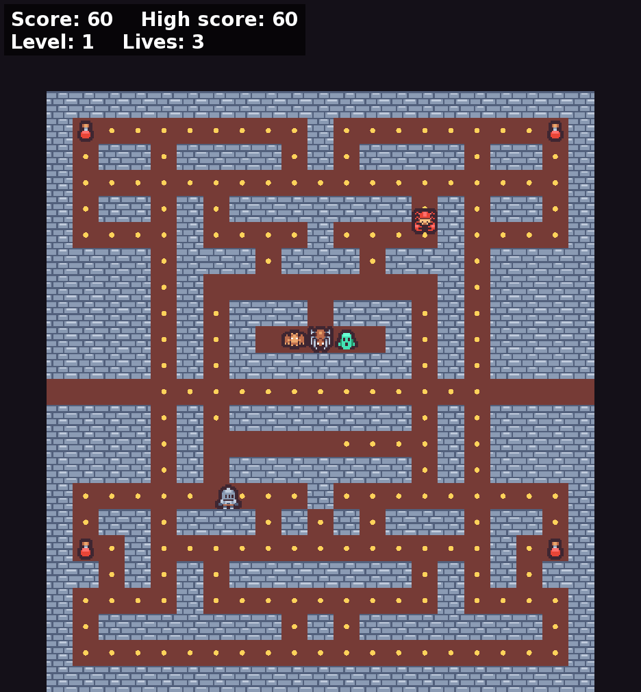

# Dungeon

A maze-chase game in C++17 and SFML 2: a knight collects the coins of a dungeon while four monsters chase him. Potions make the monsters vulnerable. The music is synthesized at runtime from MIDI files, and grows more intense as the monsters get closer.



Arrow keys move, Esc pauses, Enter picks a menu option.

## Build

Needs SFML 2, CMake and the [disciplina-de-jogos](https://github.com/baldoqui/disciplina-de-jogos) repo in the same parent folder.

```sh
cmake -S . -B build && cmake --build build
./build/dungeon
```

## Credits

All art and fonts are by [Kenney](https://kenney.nl), under CC0:

- [Tiny Dungeon](https://kenney.nl/assets/tiny-dungeon): maze, characters, potion ([license](assets/kenney/tiny-dungeon/License.txt)).
- [Pixel UI Pack](https://kenney.nl/assets/pixel-ui-pack): HUD and menu panels ([license](assets/kenney/pixel-ui/License.txt)).
- [Kenney Fonts](https://kenney.nl/assets/kenney-fonts): text and title fonts ([license](assets/kenney/fonts/License.txt)).

Music: [15 Melodic RPG Chiptunes](https://opengameart.org/content/15-melodic-rpg-chiptunes) by Aureolus_Omicron, CC0 ([license](assets/music/License.txt)).

MIDI loading: [TinyMidiLoader](https://github.com/schellingb/TinySoundFont) by Bernhard Schelling, zlib license (`third_party/tml.h`, unmodified).

Built with [SFML](https://www.sfml-dev.org/). Code under the [MIT license](LICENSE).
