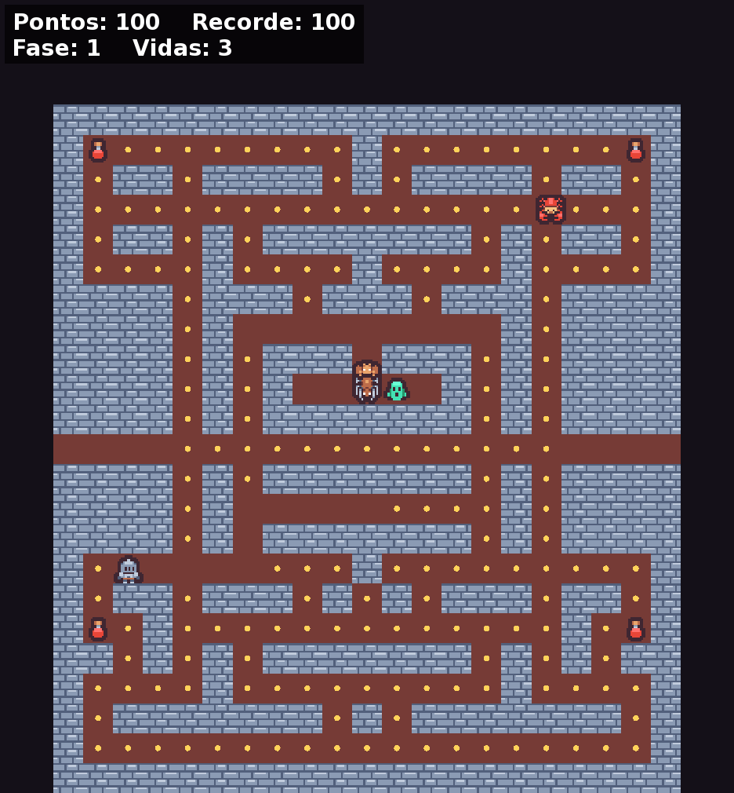

# Dungeon

Jogo de labirinto com perseguição, em C++17 e SFML. Um cavaleiro junta as moedas de uma masmorra enquanto quatro monstros o caçam, cada um com o seu jeito de perseguir.



É inspirado no gênero dos jogos de labirinto com perseguição dos anos 80, como Pac-Man. Não tem nenhuma ligação com Pac-Man nem com a Bandai Namco, dona da marca, e não usa nada do jogo original: o labirinto, os personagens, os nomes, a arte e o código são outros.

Foi feito durante a disciplina de Jogos (CC37G / CC41Y) da UTFPR, sem engine. As classes de matemática, colisão e caminho mínimo (A*) vêm do repo [disciplina-de-jogos](https://github.com/baldoqui/disciplina-de-jogos), feito nas atividades da disciplina.

## Como jogar

- As **setas** escolhem a direção. O cavaleiro segue andando sozinho até a próxima parede e vira na primeira esquina em que a direção pedida estiver livre. Meia-volta é na hora.
- Junte todas as **moedas** (10 pontos cada) para passar de fase.
- As **poções**, nos quatro cantos (50 pontos), deixam os monstros vulneráveis por alguns segundos, com uma barra no placar mostrando o tempo. Eles viram fantasmas e fogem. Pegar um vale 200, o próximo 400, depois 800 e 1600. Quando a poção está acabando, eles piscam.
- Encostar num monstro fora da poção custa uma vida. Com as 3 vidas perdidas, o jogo acaba, e **R** recomeça.
- A linha do meio é um **túnel**: sair por um lado é entrar pelo outro.
- A cada fase, os monstros ficam um pouco mais rápidos e a poção dura menos.

## Os monstros

Os quatro andam pelo caminho mais curto (A*) até um tile-alvo. O que muda é o alvo:

| Monstro | Aparência | Alvo |
|---|---|---|
| Bruto | demônio | o cavaleiro |
| Espreita | morcego | 4 tiles à frente do cavaleiro |
| Cerco | aranha | o ponto 2 tiles à frente do cavaleiro, espelhando a posição do Bruto, para os dois fecharem o cavaleiro pelos dois lados |
| Medroso | gosma | o cavaleiro quando está longe; o próprio canto quando chega a menos de 8 tiles |

De tempos em tempos (7 s a cada 20 s de perseguição), todos param de perseguir e vão cada um para o seu canto. No começo de cada vida, saem do curral um de cada vez.

## Compilar

Precisa de:

- um compilador C++17 e CMake 3.16 ou mais novo;
- **SFML 2** (testado com a 2.6.2; a 2.5 deve funcionar). A SFML 3 mudou a API e não serve;
- o repo [disciplina-de-jogos](https://github.com/baldoqui/disciplina-de-jogos) na mesma pasta que este;
- GoogleTest, só para os testes.

```sh
git clone https://github.com/baldoqui/disciplina-de-jogos
git clone https://github.com/baldoqui/dungeon
cd dungeon
cmake -S . -B build
cmake --build build
./build/dungeon
./build/testes     # testes das regras, sem abrir janela
```

O `disciplina-de-jogos` pode ficar em outro lugar, se você passar `-DLIB_DIR=/caminho/para/disciplina-de-jogos/source` ao CMake.

### SFML 2 em distribuições que só têm a 3 (Arch, por exemplo)

Dá para compilar a SFML 2.6 sem mexer no sistema, instalando em `~/.local/opt/sfml-2.6`, que é onde o CMake deste projeto procura:

```sh
curl -L -o sfml.tar.gz https://github.com/SFML/SFML/archive/refs/tags/2.6.2.tar.gz
tar xzf sfml.tar.gz
cmake -S SFML-2.6.2 -B sfml-build -DCMAKE_BUILD_TYPE=Release \
      -DSFML_BUILD_AUDIO=OFF -DSFML_BUILD_NETWORK=OFF \
      -DCMAKE_INSTALL_PREFIX="$HOME/.local/opt/sfml-2.6"
cmake --build sfml-build
cmake --install sfml-build
```

No Ubuntu e no Debian, `sudo apt install libsfml-dev` costuma instalar uma SFML 2.

## Código

| Arquivo | O quê |
|---|---|
| `src/Main.cpp` | Liga as regras à janela |
| `src/Jogo.*` | Regras: etapas (preparar, jogando, pego, fase completa, fim de jogo), pontos, vidas, fases, poção |
| `src/Ator.*` | Movimento em grade contínuo, usado pelo cavaleiro e pelos monstros, e o túnel |
| `src/Monstros.*` | Alvo de cada monstro, A*, fuga |
| `src/Labirinto.*` | Lê o labirinto de `assets/labirinto.txt` (a legenda está em `Labirinto.hpp`) |
| `src/Tela.*` | Janela: câmera, labirinto, itens, personagens e placar |
| `test/JogoTest.cpp` | Testes das regras (GoogleTest) |

O labirinto é um arquivo de texto, então dá para desenhar outro: `#` parede, `.` moeda, `o` poção, `H` início do cavaleiro, `P` curral, `-` porta do curral, espaço para corredor vazio. Uma linha com as duas pontas abertas vira túnel. Os corredores têm um tile de largura; um bloco 2×2 aberto faria o A* andar na diagonal, e um dos testes confere isso.

## Limitações conhecidas

- Não tem som.
- O recorde não fica salvo: some quando a janela fecha.
- Só tem um labirinto, e não tem tela de título.
- O A* não conhece o túnel, então os monstros não o usam para perseguir (às vezes passam por ele quando estão fugindo).
- Só foi testado no Linux.

## Créditos e licenças

O **código** deste repo está sob a [licença MIT](LICENSE).

A **arte** (paredes, chão, cavaleiro, monstros, fantasma e poção) é do pacote **Tiny Dungeon**, de [Kenney](https://www.kenney.nl), sob [CC0 1.0](https://creativecommons.org/publicdomain/zero/1.0/): é domínio público, de uso livre, e não exige crédito; ele está aqui por gentileza.

- Página do pacote: [kenney.nl/assets/tiny-dungeon](https://kenney.nl/assets/tiny-dungeon)
- Onde foi baixado, em 09/11/2026: [opengameart.org/content/tiny-dungeon](https://opengameart.org/content/tiny-dungeon) (também em [kenney-assets.itch.io/tiny-dungeon](https://kenney-assets.itch.io/tiny-dungeon))
- Licença original do pacote: [`assets/kenney/License.txt`](assets/kenney/License.txt)

Os arquivos em `assets/kenney/` são tiles do pacote, só renomeados:

| Arquivo | Tile original |
|---|---|
| `parede.png` | `tile_0040.png` |
| `chao.png` | `tile_0000.png` |
| `cavaleiro.png` | `tile_0096.png` |
| `demonio.png` (Bruto) | `tile_0110.png` |
| `morcego.png` (Espreita) | `tile_0120.png` |
| `aranha.png` (Cerco) | `tile_0122.png` |
| `gosma.png` (Medroso) | `tile_0108.png` |
| `fantasma.png` (monstro vulnerável) | `tile_0121.png` |
| `pocao.png` | `tile_0115.png` |

A **fonte** do placar é a [DejaVu Sans](https://dejavu-fonts.github.io/) (`assets/DejaVuSans-Bold.ttf`), sob licença livre ([`assets/DejaVuSans-LICENSE.txt`](assets/DejaVuSans-LICENSE.txt)).

As moedas e o labirinto foram feitos para este jogo.
